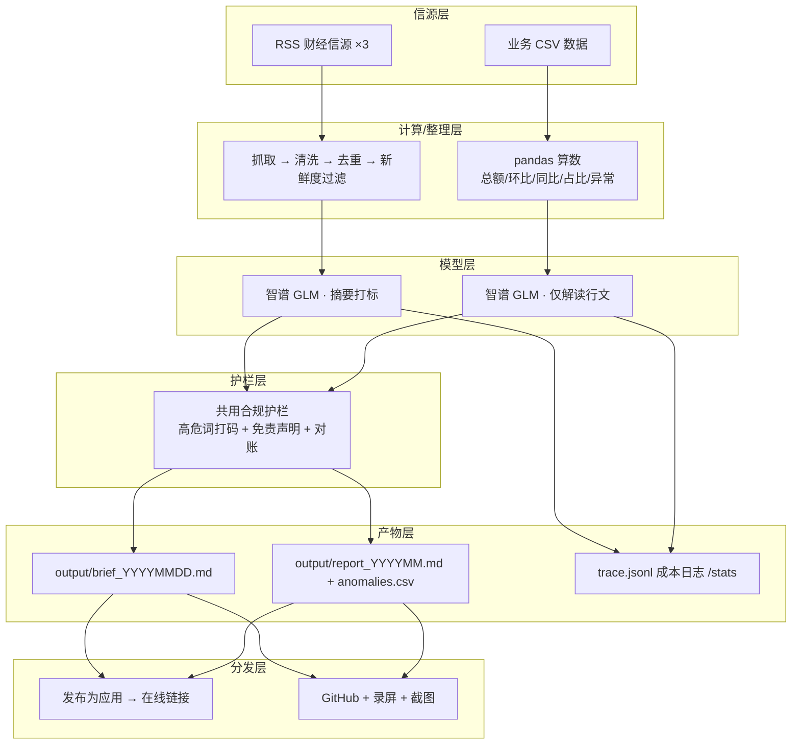

# 作品集总架构

> 金融 + 科技垂直的「流程重写者」作品集。两条轨道、两个已验证 Demo、一道共用合规护栏。

## 一、双轨策略

| 轨道 | 用途 | 技术栈 | 能否一键发布链接 |
|---|---|---|---|
| **v0.1 验证体** | 验证客户要不要、做演示、做获客素材 | Python + FastAPI | ✅ 能，用 WorkBuddy「发布为应用」 |
| **v1.0 交付体** | 私有化交付、建立壁垒、收定制费 | Java 17 + Spring Boot + Spring AI | ❌ 不能，只用 GitHub + 录屏 + 截图对外 |

## 二、总架构图（Mermaid）

## 三、设计要点

1. **模型只做「信息整理 / 行文」，所有数字与判断来自上游确定性模块**（抓取、pandas）。模型被系统提示词约束为「只陈述事实、不预测、不给建议」。
2. **合规护栏共用**：高危词扫描、免责声明、对账校验统一在 `agent-demos/check_compliance.sh` 与 `_shared/` 下维护，两 Demo 复用。
3. **可观测**：每次运行写 `trace.jsonl`，`/stats` 汇总 Token、耗时、成本，方便对客户讲「多少钱一次」。
4. **发布形态**：v0.1 走「发布为应用」拿在线链接直接获客；v1.0 走 GitHub + 录屏 + 截图做私有化交付背书。
