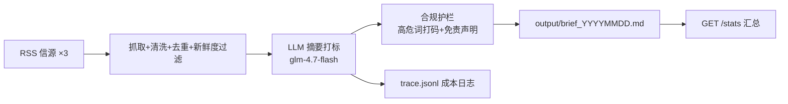

# 投研情报 Agent · v0.1（验证体 / 可一键发布）

> 金融 + 科技垂直的「流程重写者」系列 Demo 之一。
> 抓取多信源财经资讯 → 清洗去重 → 大模型摘要打标 → 生成一份带免责声明的 Markdown 简报。
> **定位**：给客户「点开就能用」的验证体，用 WorkBuddy「发布为应用」拿到在线链接。Java 版（v1.0）用于私有化交付，详见根目录 `TECH_DECISION.md`。

---

## 一、它解决什么问题

研究/投研/财经运营每天要刷 N 个信源，信息散、易漏、整理慢。这个 Agent 把「刷 + 整理 + 成稿」压缩成一次点击，产出结构统一、要点清晰、且**合规自检已过**的情报简报。

## 二、核心数字（2026-10-16 实测）

| 指标 | 数值 |
|---|---|
| 单轮产出 | 3–5 条资讯 → 1 份结构化简报 |
| 单次耗时 | 约 20–25 秒（实测 22.8 秒 / 4 条） |
| 单次 Token | 约 1664 tokens |
| 单次成本 | **约 0.0012 元**（默认 `glm-4.5-flash`，按公开价格估算，以控制台为准） |
| 免费备选 | `glm-4.7-flash` 官方免费，但高峰期限流严重，演示慎用 |
| 合规 | 高危词 0 命中、末尾强制免责声明 |

## 三、功能特性

1. **多信源聚合**：3 个公开 RSS 信源，单源失败不影响整体（已实测降级可用）。
2. **新鲜度过滤**：只保留近 7 日条目，自动丢弃陈旧/无发布时间的内容。
3. **大模型摘要 + 打标**：输出「利好 / 中性 / 风险」三档标签，摘要 ≤80 字。
4. **合规护栏**：发布前按 `_shared/high_risk_words.txt` 扫描，命中词自动打码，输出末尾强制附加免责声明。
5. **可观测**：`trace.jsonl` 记录每次运行的信源数、Token、耗时、成本、是否走兜底。
6. **可演示**：内置网页（GET `/`），点击即生成；也支持临时填入 Key（仅内存，不落盘）。

## 四、架构



## 五、本地运行

```bash
cd agent-demos/v0-invest-intel
python3 -m venv .venv && .venv/bin/pip install -r requirements.txt

# 1) 准备密钥：复制并填入你的智谱 Key
cp ../../.env.example .env        # 或在 agent-demos/.env 中统一配置
#    ZHIPU_API_KEY=你的Key
#    ZHIPU_BASE_URL=https://open.bigmodel.cn/api/paas/v4
#    ZHIPU_MODEL=glm-4.7-flash

# 2) 启动
.venv/bin/python -m uvicorn app:app --host 127.0.0.1 --port 8000

# 3) 使用
#    浏览器打开 http://127.0.0.1:8000  →  点「生成今日简报」
#    或命令行：curl -X POST http://127.0.0.1:8000/run
#    查看历史：curl http://127.0.0.1:8000/latest
#    成本汇总：curl http://127.0.0.1:8000/stats
```

> 密钥在 `agent-demos/.env`（已被 `.gitignore` 忽略，不会进 Git）。也可在网页/请求体临时提供 Key，仅本次请求内存中使用。

## 六、输出样例（节选，真实抓取）

```markdown
# 投研情报简报 · 2026-10-16

> 生成时间：2026-10-16 14:20（北京时间）　信源：3 个　条目：5 条

## 一、今日要点
- 【利好】2025年中国研发经费投入总量突破3.9万亿元
- 【中性】绥芬河公路口岸进出境货运车辆数创新高
- 【中性】中国启动铁路列车车次编排改革 新增X字头列车

## 二、分条摘要
### 1. 【利好】2025年中国研发经费投入总量突破3.9万亿元
2025年中国研发经费投入总量突破3.9万亿元，同比增长8.2%，位居世界第二。
- 来源：中新网·要闻　原文：https://www.chinanews.com.cn/cj/2026/10-16/10715606.shtml
```

## 七、设计取舍（为什么这么做）

- **模型只做摘要与打标，不做任何投资判断**：系统提示词强制「只陈述事实、不预测涨跌、不给买卖建议」，且输出末尾强制免责声明。金融红线优先于「智能感」。
- **免费档串行调用**：智谱免费模型并发约 1，故对所有条目做串行调用 + 指数退避重试，宁可慢一点也不触发 429。
- **离线兜底**：3 个信源全挂时自动切换到内置示例数据，保证 Demo 永远能跑出东西（且明确标注「示例数据，非真实新闻」）。

## 八、已知限制

- 信源目前是 3 个中新网 RSS（新浪财经 RSS 返回 2008 年陈旧条目，已被新鲜度过滤剔除）；如要扩源，改 `app.py` 顶部 `SOURCES` 即可。
- 打标「利好/中性/风险」由模型根据标题判断，仅供参考，不保证与专业研判一致。
- **限流已实测**：`glm-4.7-flash` 免费档在高峰期返回 429（code 1305/1302），曾导致单次耗时涨到 210 秒且 3/4 条摘要失败。因此默认改用 `glm-4.5-flash`（约 0.0012 元/次），并在限流时**自动回退为规则摘录**（取原文首句，不编造），保证 Demo 永远有可用输出。
- `glm-5.3-flash` 等模型不支持关闭思考模式（报错 code 1210），代码已在重试时自动去掉该参数。

## 九、合规

- 发布前请务必运行根目录 `bash check_compliance.sh`，对 `output/` 做高危词 + 免责声明 + 密钥泄漏 + 隐私扫描。
- 本工具**仅供参考，不构成投资建议**。所有输出均附免责声明。

## 十、许可

MIT License · © 2026 cuiyaohan。见根目录 `LICENSE`。
