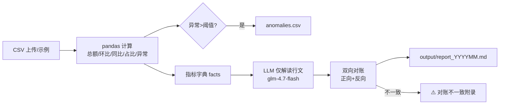

# 数据报表自动化 Agent · v0.1（验证体 / 可一键发布）

> 金融 + 科技垂直的「流程重写者」系列 Demo 之二。
> 上传一份 CSV → `pandas` 算完所有数字 → 大模型**只做解读与行文** → 自动做数字对账。
> **核心理念**：数字不让模型算，模型只负责把算好的数字讲清楚。这是它和「让 AI 直接算数」类工具最本质的区别，也是交付时能卖上价的点。

---

## 一、它解决什么问题

每月经营月报、周报里大量时间花在「拉数 + 算同比环比 + 写三段话」。这个 Agent 把数字计算交给确定性的 `pandas`，把「写公文」交给大模型，并且**自动核对**：报告里的每个数字都能在计算结果里找到，模型没瞎编、没算错。

## 二、核心数字（2026-10-16 实测，自带示例数据）

| 指标 | 数值 |
|---|---|
| 输入 | 1 份 CSV（列：`date, category, revenue, cost`） |
| 输出 | 1 份 Markdown 月报 + `anomalies.csv`（波动异常清单） |
| 自动对账 | ✅ 通过（报告全部数字均能在计算结果中找到） |
| 异常识别 | 默认阈值 ±20%，本期识别 4 项异常（产品线C 环比/同比下滑、产品线A/B 同比增长） |
| 单次耗时 | 约 11–15 秒（实测 2 次：14.7s / 11.3s） |
| 单次 Token | 约 1558 tokens |
| 单次成本 | **约 0.0015 元**（默认 `glm-4.5-flash`，按公开价格估算） |
| 合规 | 高危词 0 命中、末尾强制免责声明 |

## 三、功能特性

1. **数字由 pandas 计算**：总额、成本、毛利、毛利率、环比、同比、各品类占比，全部确定性计算。
2. **大模型只做解读**：提示词硬性约束「只能使用给定数字、禁止自行计算、禁止四舍五入改写、禁止补充新数字」。
3. **双向对账**：①正向——每个关键指标必须出现在报告里；②反向——报告中带单位/百分号的数字必须都能在计算结果中找到。任一项不通过即在报告末尾写「⚠️ 对账不一致」。
4. **异常清单**：波动超过阈值（默认 ±20%）的品类/指标自动导出为 `anomalies.csv`，并写入报告。
5. **可演示**：内置网页（GET `/`），填路径或用示例数据即可生成；支持临时填入 Key（仅内存）。

## 四、架构



## 五、本地运行

```bash
cd agent-demos/v0-report-automation
python3 -m venv .venv && .venv/bin/pip install -r requirements.txt

# 密钥同 v0-invest-intel，统一在 agent-demos/.env 配置
#   ZHIPU_API_KEY=你的Key
#   ZHIPU_BASE_URL=https://open.bigmodel.cn/api/paas/v4
#   ZHIPU_MODEL=glm-4.7-flash

.venv/bin/python -m uvicorn app:app --host 127.0.0.1 --port 8001

# 使用
#   浏览器打开 http://127.0.0.1:8001  →  点「生成月报」
#   或：curl -X POST http://127.0.0.1:8001/report -H "Content-Type: application/json" -d '{}'
#   查看：curl http://127.0.0.1:8001/latest
```

> 自带 `sample_data/sample.csv`（脱敏示例：产品线A/B/C，13 个月），直接空跑即可看到效果。

## 六、对账表示例（节选）

| 指标 | 计算值 | 报告中是否出现 |
|---|---|---|
| 2026-03 总营收 | 2672.0 | 是 |
| 2026-03 毛利 | 1012.0 | 是 |
| 总营收同比(%) | 21.45 | 是 |
| 产品线C 营收环比(%) | -35.0 | 是 |
| … | … | … |

**对账结论：报告中出现的全部数字均能在 pandas 计算结果中找到，一致。**

## 七、设计取舍

- **不让模型算数**：LLM 在数学与一致性上不值得信任，确定性的事情交给 `pandas`，把「创意/表达」留给模型。这是产品卖点，也是对账护栏存在的前提。
- **对账而非信任**：即便模型被约束「不准算」，仍用正则把报告数字与计算结果双向比对——防的是模型「幻觉出一个看起来合理但算错的数」。
- **异常阈值可配**：`ANOMALY_THRESHOLD` 默认 0.20，按需调整。

## 八、已知限制

- CSV 列名需为 `date, category, revenue, cost`；日期列需能解析为月份。
- 同比需要往前 12 个月的数据，数据不足时该指标输出「数据不足，跳过」（不会瞎算）。
- 默认免费模型高峰期可能限流；生产可换付费模型。

## 九、合规

- 发布前运行根目录 `bash check_compliance.sh`。
- 本工具**仅供参考，不构成投资建议**。输出含免责声明。

## 十、许可

MIT License · © 2026 cuiyaohan。见根目录 `LICENSE`。
